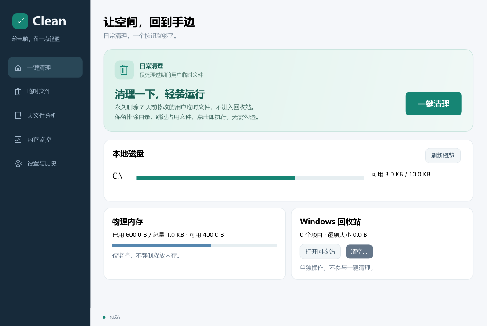

# Clean

免费、开源、本地运行的 Windows 磁盘清理工具。首页点击“一键清理”，自动扫描并永久删除过期的用户临时文件，无需逐项勾选或再次确认。中文界面，C# / .NET 10 / WPF / MVVM，MIT 许可证。



**当前为 v0.2.3 预发布开发版本。** 一键清理仅处理当前用户临时目录中至少 7 天未修改的文件，遵循排除目录并逐项复核；不自动处理大文件或回收站。本地功能与自动化验证详见 [测试报告](docs/test-report.md)；尚未完成干净 Windows 虚拟机等正式发布验收，未上传 GitHub。

已实现：

- 固定磁盘概览、当前用户临时文件扫描、用户指定目录的大文件分析。
- 一键清理过期临时文件，自动扫描、执行和显示结果；支持中途停止。
- 手动模式保留目录排除、默认不勾选、清理预览、回收站优先和单独确认永久删除。
- 五项图标导航；清理详情仅从任务中打开，附带返回入口。紧凑设置与历史，空列表不显示大片空白表格。
- 逐项身份与元数据复核、取消后续操作、逐项报告、限量本地历史。
- 物理内存与进程工作集监控、配置原子保存与损坏恢复。

不包含注册表清理、强制释放内存、进程终止、浏览器数据清理、提权服务、遥测或自动更新。移入回收站通常不释放磁盘空间；候选逻辑大小不等于实际可回收空间。回收站的残余竞态和发布限制见 [ADR-002](docs/adr/002-windows-deletion.md)。

目标环境：Windows 11 x64。自包含 ZIP 解压后运行 `Clean.exe`，无需安装 SDK。包未签名，核对来源与 SHA-256，不关闭 Windows 系统保护。完整流程见 [使用说明](docs/user-guide.md)。

开发构建（先安装 global.json 指定的 .NET SDK）：

```powershell
pwsh ./scripts/build.ps1
pwsh ./scripts/build.ps1 -Benchmark
pwsh ./scripts/publish.ps1
```

产物在 `artifacts/Clean-0.2.3-win-x64.zip`，校验文件为同名 `.sha256`；可运行目录为 `artifacts/publish/0.2.3/win-x64`。发行包包含 .NET 运行时，所以体积大于应用自身。打包不自动推送或发布。

项目分层为 `Clean.Core`（策略/用例）、`Clean.Windows`（系统接口）、`Clean.App`（WPF/MVVM）。规格见 [docs/specs](docs/specs)，需求追踪见 [docs/tasks.md](docs/tasks.md)。贡献和安全报告见 [CONTRIBUTING.md](CONTRIBUTING.md)、[SECURITY.md](SECURITY.md)。

